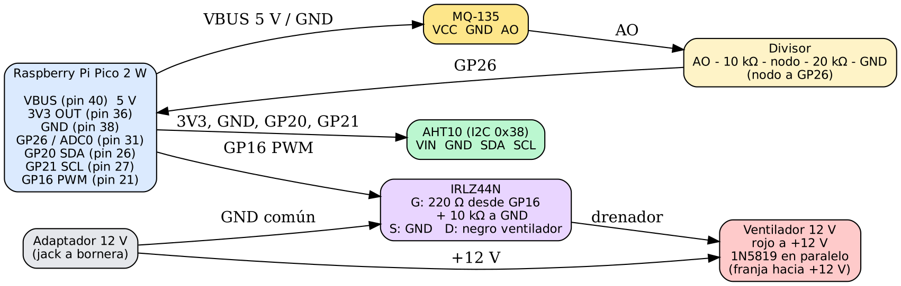
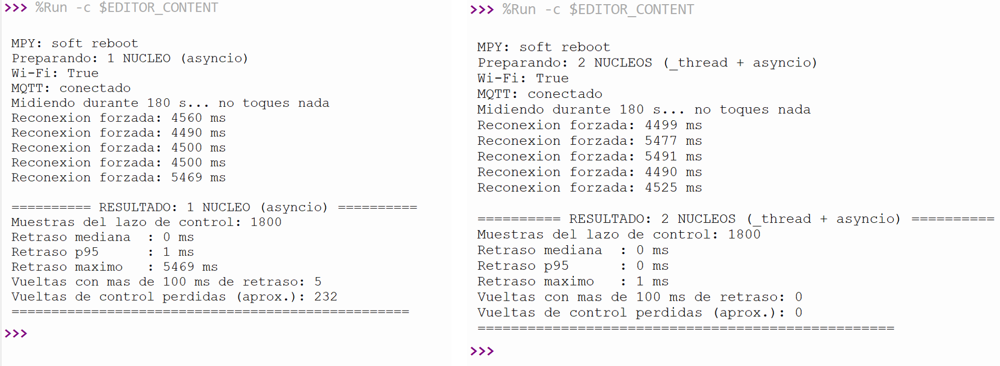
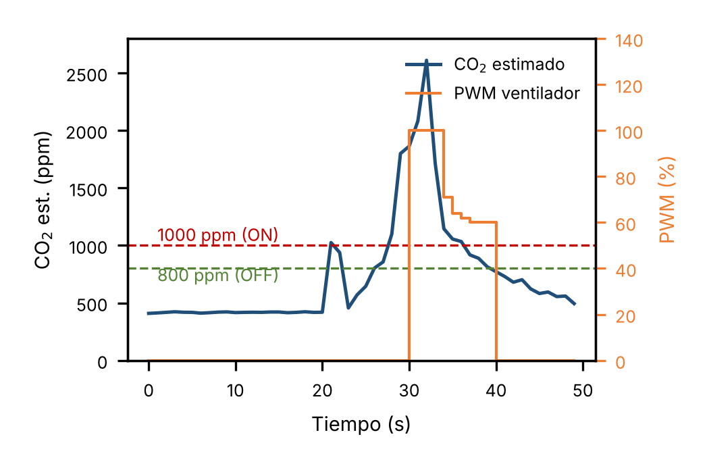
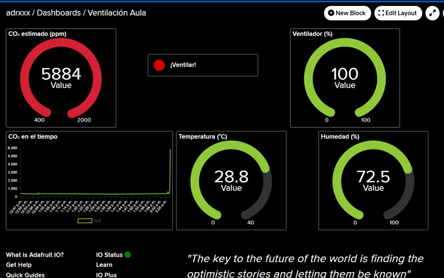

# Ventilación inteligente de aulas con Raspberry Pi Pico 2 W

Proyecto final de **Arquitectura del Computador I (16953)**, Universidad ESAN, 2026-2. Prof. Marks Calderón Niquín.

**Integrantes:** Adriano Andre Catacora Iriarte (26100120), Carmen Rosa Llaccua Marroquin (26100788), Diego Alonso Moreno Chujutalli (26100375).

Sistema IoT que **mide** el aire de un aula, **decide** si hay que ventilar, **actúa** sobre un ventilador de 12 V y **avisa** por la nube.

- **Sensor 1:** MQ-135 (calidad del aire) por **ADC**. Da un **CO₂ estimado**: el sensor no es selectivo y también reacciona a alcohol y humo.
- **Sensor 2:** AHT10 (temperatura y humedad) por **I2C** (dirección 0x38).
- **Actuador:** ventilador de 12 V controlado con **PWM** (25 kHz) mediante un MOSFET IRLZ44N.
- **Control:** histéresis. Enciende tras 3 lecturas seguidas ≥ 1000 ppm y apaga en ≤ 800 ppm. El PWM va de 60 % (1000 ppm) a 100 % (1500 ppm).
- **Nube:** MQTT a **Adafruit IO**, con un dashboard que muestra el CO₂, la temperatura, la humedad, el PWM y la alerta.
- **Reto de arquitectura: Dos núcleos.** El control corre en el núcleo 1 (`_thread`) y la red en el núcleo 0 (`asyncio`).

## Estructura

```
codigo/
  prueba_local.py       Sensores + histéresis + ventilador, sin nube
  ventilacion_nube.py   Programa completo con Wi-Fi, MQTT y alerta
  reto_1_nucleo.py      Reto: medición "antes" (todo en 1 núcleo)
  reto_2_nucleos.py     Reto: medición "después" (control en núcleo 1)
  secrets_ejemplo.py    Plantilla de credenciales (copiar como secrets.py)
cad/
  Carcasa_BASE.stl      Base (181 × 158,5 × 95 mm): rejilla de panal, cuna del
                        ventilador sin tornillos, ojales para pared, patitas
  Carcasa_TAPA.stl      Tapa con faldón que encaja por fuera de la base
  generador_base.py     Modelo paramétrico de la base (Python + trimesh)
  generador_tapa.py     Modelo paramétrico de la tapa
  vista_previa.png
docs/
  Paper_Ventilacion_Inteligente_Pico2W.pdf
  img/                  Diagrama de conexiones y resultados
```

## Diagrama de conexiones



| Señal | Pin de la Pico | Conexión |
|---|---|---|
| 5 V | 40 (VBUS) | VCC del MQ-135 |
| 3,3 V | 36 (3V3 OUT) | VIN del AHT10 |
| GND | 38 | Riel de tierra común (también el − del adaptador de 12 V) |
| ADC0 | 31 (GP26) | Nodo del divisor: AO → 10 kΩ → nodo → 20 kΩ → GND |
| SDA | 26 (GP20) | SDA del AHT10 |
| SCL | 27 (GP21) | SCL del AHT10 |
| PWM | 21 (GP16) | Compuerta del IRLZ44N a través de 220 Ω; 10 kΩ de compuerta a GND |

El divisor deja pasar 2/3 del voltaje del sensor, por eso el código lo multiplica por 1,5: V_sensor = V_ADC × 1,5.

El ventilador va con el rojo a +12 V y el negro al drenador del MOSFET. El diodo 1N5819 va en paralelo con el ventilador, con la franja hacia +12 V.

## Cómo usarlo

1. Instalar **Thonny** y elegir el intérprete *MicroPython (Raspberry Pi Pico)*.
2. Para `ventilacion_nube.py` y los programas del reto, instalar `umqtt.simple` en la Pico (Herramientas → Administrar paquetes).
3. Copiar `codigo/secrets_ejemplo.py` como `secrets.py`, llenar el Wi-Fi (2,4 GHz) y la key de Adafruit IO, y **guardarlo en la Pico**. Nunca subirlo al repositorio.
4. Correr el programa con el USB conectado y luego conectar el adaptador de 12 V. Para detenerlo, presionar STOP: el ventilador se apaga solo.

## Resultados

### Reto Dos núcleos

Lazo de control de 100 ms, 180 s (1800 vueltas), publicación MQTT cada 3 s y 5 reconexiones Wi-Fi forzadas (una cada 30 s).

| Métrica | 1 núcleo | 2 núcleos |
|---|---|---|
| Retraso mediana | 0 ms | 0 ms |
| Retraso p95 | 1 ms | 0 ms |
| **Retraso máximo** | **5469 ms** | **1 ms** |
| Vueltas con más de 100 ms de retraso | 5 | 0 |
| **Vueltas de control perdidas** | **232 (≈ 23 s)** | **0** |

Con un solo núcleo, cada reconexión del Wi-Fi congela el control. Con dos núcleos, la red tarda lo mismo en reconectarse, pero el control no se retrasa.



### Prueba con alcohol

El CO₂ estimado subió de 420 a 2611 ppm. El ventilador encendió al 100 % en la tercera lectura sobre 1000 ppm, bajó a 71, 64, 62 y 60 % y se apagó al llegar a 772 ppm.



### Dashboard



## Limitaciones

- El MQ-135 no mide CO₂ de forma selectiva; los valores son **estimaciones** relativas a una línea base de aire limpio.
- La estimación no está compensada por temperatura ni humedad.
- El ventilador de 80 mm representa al actuador; no ventila un aula real.

## Uso de IA

Se usó el asistente Claude (Anthropic) como apoyo en la redacción, el cableado guiado, los programas de prueba y medición y el modelo 3D. El montaje, la integración y las mediciones las hizo el equipo.
